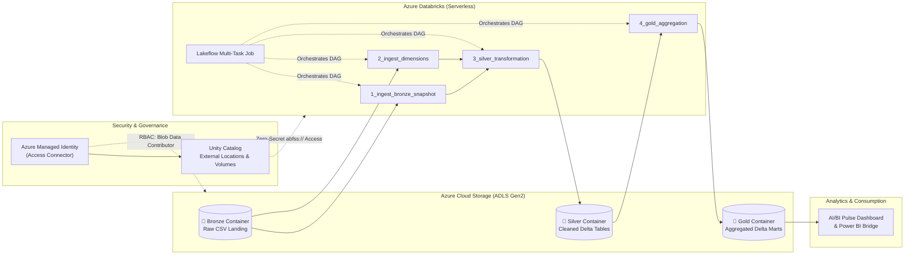
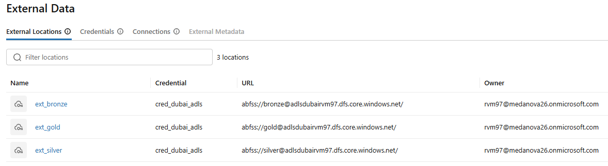
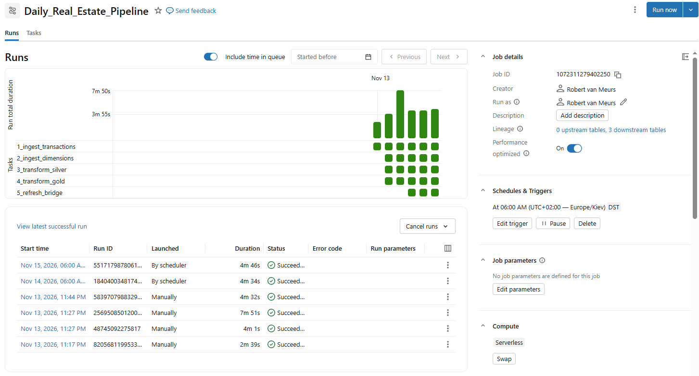
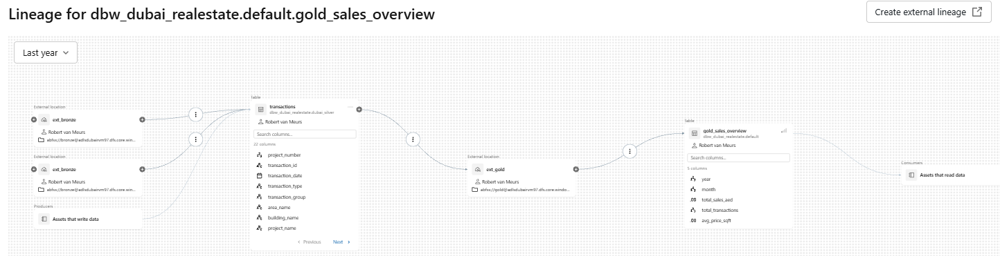
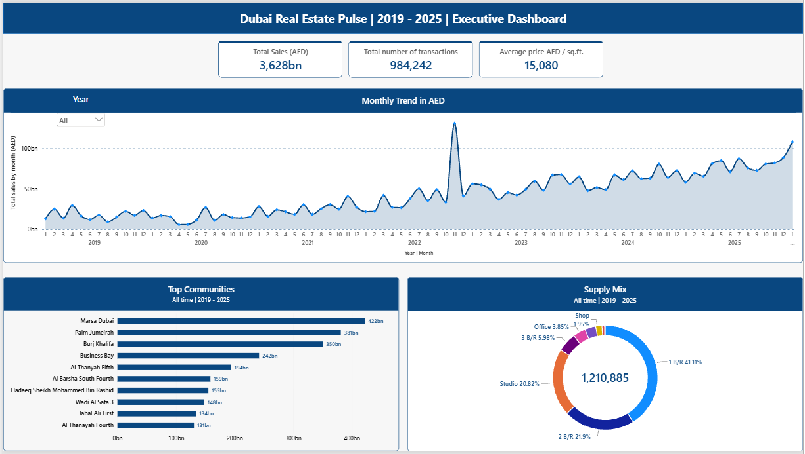

# 🏙️ Dubai Real Estate Lakehouse Pipeline (Azure Databricks & Unity Catalog)

An end-to-end cloud data engineering pipeline implementing the **Medallion Architecture (Bronze → Silver → Gold)** on **Azure Databricks Serverless Compute** and **Azure Data Lake Storage Gen2 (ADLS Gen2)**. 

This pipeline ingests, cleans, enriches, and aggregates **2.9+ million real estate records** (1.65M+ property transactions and 1.26M+ unit records) from the Dubai Land Department (DLD) to power executive analytics on pricing trends, area performance, and off-plan vs. ready property supply.

---

## 🏗️ Architecture Overview



---

## 🚀 Key Engineering Highlights

* **Zero-Secret Cloud Governance (Unity Catalog):** Eliminated hardcoded storage account keys (`spark.conf.set`) by configuring an **Azure Databricks Access Connector** with System-Assigned Managed Identity (`Storage Blob Data Contributor`) mapped to **Unity Catalog External Locations** (`ext_bronze`, `ext_silver`, `ext_gold`).
* **Serverless-First Architecture:** Designed all ingestion, transformation, and aggregation notebooks to run on stateless **Databricks Serverless Compute**, ensuring instant startup and zero idle cluster costs.
* **ANSI-Safe Schema & Type Resilience:** Handled dirty string `"null"` literals and malformed date strings in raw DLD CSV files under strict Spark ANSI mode using `try_cast` and `try_to_date` expressions, preventing runtime pipeline failures.
* **Automated Multi-Task Orchestration:** Chained all four notebooks into a reproducible **Lakeflow Job** DAG with dependency management and automated Delta table registration for downstream BI tools.

---

## 📂 Repository Structure

```text
dubai-real-estate-project/
├── 1_ingest_bronze_snapshot.ipynb           # Raw transactions ingestion & landing zone management
├── 2_ingest_dimensions_units_projects.ipynb # Dimension ingestion (Projects & Units master data)
├── 3_silver_transformation.ipynb            # Deduplication, ANSI-safe casting, enrichment & joins
├── 4_gold_transformation.ipynb              # Business-level KPI aggregations & Gold Delta marts
├── 5_powerbi_bridge.ipynb                   # Registers Gold Delta tables in Unity Catalog for BI
├── bi/
│   └── Dubai_Real_Estate_Pulse.pbix         # Interactive Power BI report (Import mode)
├── setup/
│   └── 00_unity_catalog_governance.sql      # DDL reference for Credentials, External Locations & Volumes
├── workflows/
│   └── dubai_medallion_pipeline.yml         # Exported Lakeflow Job DAG configuration
├── assets/
│   └── screenshots/                         # Architecture, Lineage, Job DAG & Dashboard visuals
└── README.md

```
---

## 🔄 Medallion Layer Breakdown

| Layer | Storage Format | Key Transformations & Business Logic | Scale / Output |
| :--- | :--- | :--- | :--- |
| **🥉 Bronze** | Raw CSV (`ADLS Gen2`) | Landed raw DLD datasets (`transactions`, `projects`, `units`) into governed landing directories via Unity Catalog External Locations. | Raw source files preserved for auditability |
| **🥈 Silver** | **Delta Lake** | • Deduplicated dimension keys (`project_number`, `property_id`)<br>• Parsed `dd-MM-yyyy` dates via `try_to_date`<br>• Enriched transactions with `price_per_sqft` and `is_offplan_flag` | **1,654,000+** Transaction rows<br>**1,264,000+** Unit rows |
| **🥇 Gold** | **Delta Lake** + Managed Tables | • `gold_sales_overview`: Monthly AED sales volume & avg price/sqft<br>• `gold_area_stats`: Top-performing Dubai communities by volume<br>• `gold_supply_stats`: Property type & bedroom supply breakdown | Registered in Unity Catalog for **AI/BI Dashboards** & **Power BI** |

---

## 📸 Pipeline Execution & Proof of Work

> *Tip: Upload your screenshots to `assets/screenshots/` in this repository and update the filenames below to render them automatically.*

### 1. Unity Catalog External Locations & Governance


### 2. Automated Lakeflow Job Orchestration (DAG)


### 3. End-to-End Data Lineage (Bronze → Silver → Gold)


### 4. Dubai Real Estate Pulse Dashboard


---

## 🛠️ Tech Stack
* **Cloud Platform:** Microsoft Azure (ADLS Gen2, Managed Identity, IAM RBAC)
* **Data Platform:** Azure Databricks (Serverless Compute, Unity Catalog, Lakeflow Jobs, Delta Lake)
* **Languages:** PySpark, Spark SQL, YAML
* **Version Control & BI:** GitHub (Databricks Git Folders), Databricks AI/BI Dashboards, Power BI
